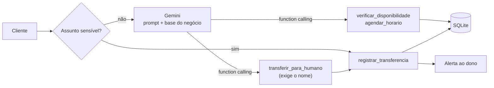
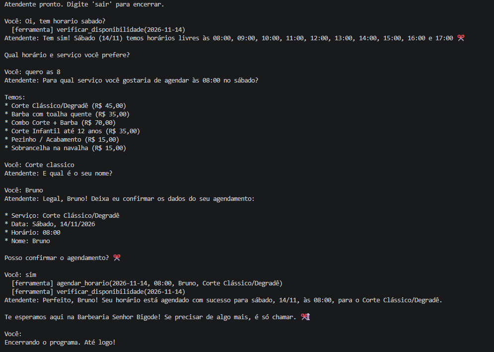
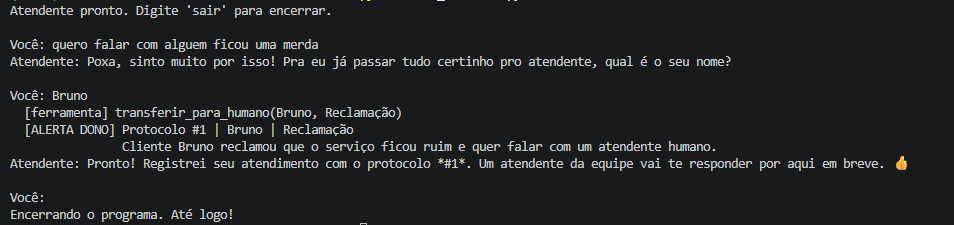
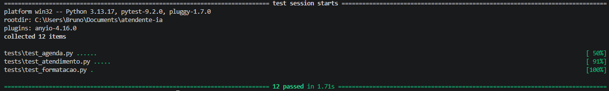

# Atendente com IA para WhatsApp

> Atendente virtual para pequenos negócios: responde dúvidas com base nas informações do negócio, consulta a agenda real, agenda horários e transfere para um humano quando necessário. Feito em **Python** com **Gemini** e **function calling**.

**Autor:** Bruno de Campos Farias · **Stack:** Python · Google Gemini (API) · SQLite · pytest

O negócio usado como exemplo é uma barbearia fictícia, a **Barbearia Senhor Bigode**.

## O problema

Pequenos negócios perdem tempo respondendo as mesmas perguntas no WhatsApp (preço, horário, endereço) e agendando à mão. Chatbots com IA resolvem isso, mas trazem dois riscos sérios: **inventar informação** e **oferecer horário que já está ocupado**.

Este projeto foi construído para atacar esses dois riscos.

## O que ele faz

- **Responde só com base nas informações do negócio** (grounding): preços, serviços, horários e políticas vêm de um arquivo de base de conhecimento. O que não está lá, ele não inventa.
- **Consulta a agenda real** antes de oferecer qualquer horário, respeitando dias da semana e **feriados nacionais e estaduais (SP) calculados automaticamente**.
- **Agenda horários** só depois de o cliente confirmar data, horário, serviço e nome.
- **Transfere para um humano** com número de protocolo e um resumo da conversa. Antes, pergunta o nome do cliente e só o que ainda falta saber, para o atendente não precisar perguntar tudo de novo.
- **Lembra da conversa** enquanto o atendimento está aberto (histórico em memória; a separação por cliente chega com a integração ao WhatsApp).
- **Formata as mensagens no padrão do WhatsApp.**

## Como funciona



A IA conduz a conversa e decide **quando** usar cada ferramenta. Os dados e as regras ficam no código.

## Decisões técnicas

O princípio do projeto: **o prompt orienta, o código garante.** O que não pode falhar não fica nas mãos da IA.

| Risco | Como foi resolvido |
|---|---|
| IA inventar preço ou serviço | Base de conhecimento no prompt de sistema, temperatura baixa e regra explícita de não inventar |
| Oferecer horário ocupado | A IA consulta a agenda via function calling e só oferece o que a função devolve |
| Agendar horário duplicado | Validação na função de agendamento e restrição `UNIQUE (data, horario)` no banco |
| Agendar serviço inexistente | A função recusa qualquer serviço fora da lista oficial |
| A IA não saber que dia é "sábado" | A data de hoje é injetada no prompt a cada execução |
| Assuntos com risco jurídico ou financeiro (Procon, reembolso, advogado) | Filtro no código, antes da IA: a mensagem é transferida direto para um humano |
| Transferir sem saber quem é o cliente | A ferramenta recusa a transferência sem nome, a menos que o cliente tenha se recusado a informar |
| Mensagem de protocolo inconsistente | O texto é montado pelo código, não pela IA |
| Instabilidade da API | Timeout e nova tentativa automática com espera crescente (1s, 2s, 4s) |

## Demonstração





## Estrutura

```
├── chat_terminal.py      # Chat no terminal: conversa, retry e formatação
├── agenda.py             # Ferramentas de agenda: disponibilidade e agendamento
├── atendimento.py        # Transferência para humano e filtro de assuntos sensíveis
├── db.py                 # Persistência em SQLite
├── listar_modelos.py     # Utilitário para listar os modelos Gemini disponíveis
├── base/
│   ├── negocios.md       # Base de conhecimento do negócio
│   └── prompt.md         # Persona e regras do atendente
└── tests/                # Testes automatizados (pytest)
```

Para usar com outro negócio, basta trocar os arquivos da pasta `base/` e a configuração de horários e serviços em `agenda.py`.

## Como rodar

```bash
python -m venv .venv
# Windows: .\.venv\Scripts\Activate.ps1   |   Linux/Mac: source .venv/bin/activate
pip install -r requirements.txt
```

Copie o `.env.example` para `.env` e coloque sua chave do Gemini (gerada no Google AI Studio).

```bash
python chat_terminal.py   # conversar com o atendente
python -m pytest          # rodar os testes
```

## Próximos passos

1. **Integração com o WhatsApp** (FastAPI + Evolution API), com uma conversa por número de cliente
2. **Alerta ao dono pelo WhatsApp**, hoje exibido no terminal
3. **Cancelamento e remarcação** de horários
4. **Painel para o dono** ver agendamentos e atendimentos abertos
5. **Memória persistente**: hoje o histórico da conversa vive só enquanto o programa está rodando